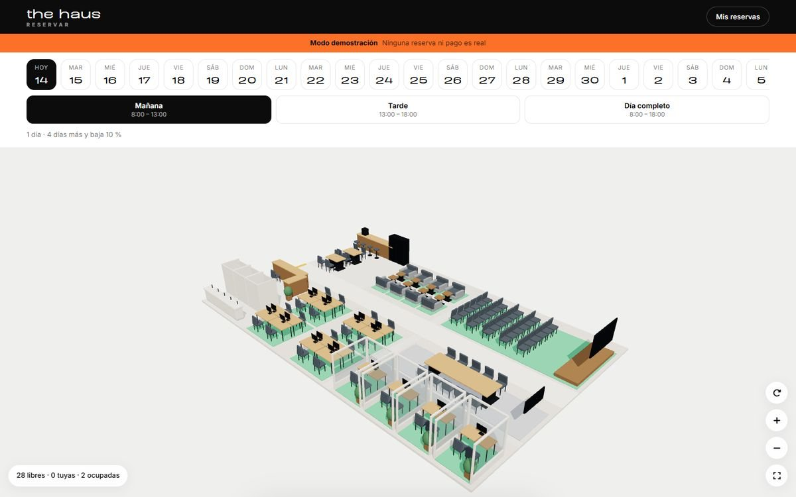
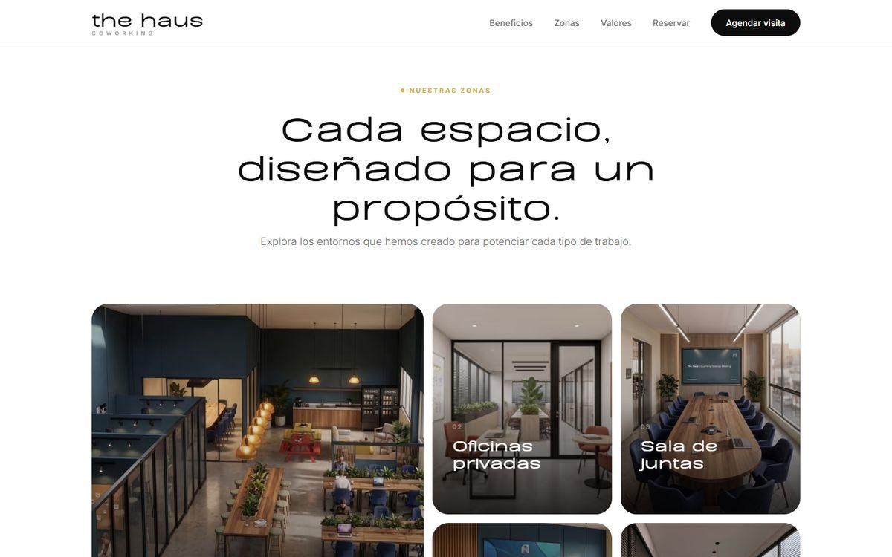

# The Haus

Landing y app de reservas para The Haus, un coworking que unos estudiantes de Administración de la UNSA plantearon como proyecto final. Lo hice para que pudieran presentar la idea con algo funcionando. Es una demostración: no hay pagos reales.

La reserva se hace sobre un plano 3D del local. Cada escritorio, sala y zona muestra si está libre para la fecha y el turno elegidos, y el plano se puede girar, acercar y seleccionar con el ratón.

[Probar el plano](https://thehaus-pink.vercel.app/app/) · [Ver la landing](https://thehaus-pink.vercel.app/)



## Qué hace

- Calendario de los próximos días con turnos de mañana, tarde y día completo.
- Reservas de varios días con descuento por volumen: 10 % desde 5 días, 15 % desde 10 y 25 % desde 20.
- Registro e inicio de sesión antes de entrar al plano, y una sección con tus reservas.
- Pasarela de pago simulada que puede aprobar, rechazar o dejar caducar el pago.
- Se instala como PWA y funciona con un service worker.

La landing presenta las zonas del local, un mapa con lo que está libre y un botón para agendar una visita.




## Cómo está hecho

HTML, CSS y JavaScript con módulos ES, sin framework y sin paso de build. El plano usa three.js, que está en `vendor/`. Las fuentes y los íconos también se sirven desde el propio sitio, así que no depende de ningún CDN. Está desplegado en Vercel.

Los precios están en `js/tarifas.js` y son provisionales. La sesión y los pagos se simulan en `js/sesion-simulada.js` y `js/pagos-simulados.js`. El backend con Supabase está diseñado en [docs/backend.md](docs/backend.md), pero no implementado.

## Estructura

```
index.html, style.css, script.js   landing
app/                               app de reservas (PWA)
js/                                plano 3D, reservas, tarifas y simulaciones
vendor/                            three.js
scripts/                           optimización de imágenes, fuentes e íconos
```

Para verlo en local hace falta un servidor estático, por ejemplo `npx serve .`, porque los módulos ES no cargan desde `file://`.

© 2026 José Luis Cuenca Gutiérrez. Todos los derechos reservados.
